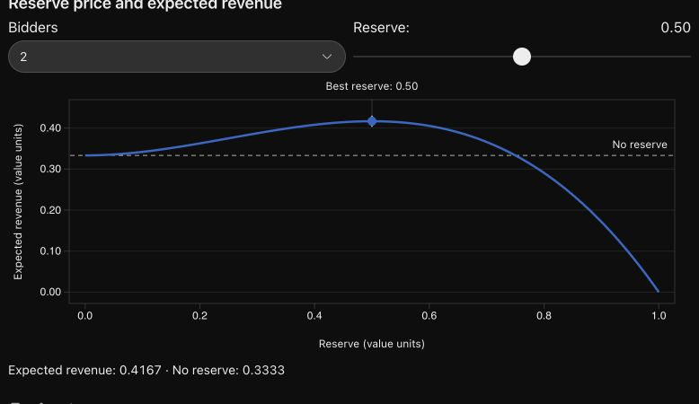

# 68. Myerson Optimal Reserve Price

## Problem statement

A seller auctions one object to $N$ risk-neutral bidders with i.i.d. values $v_i\sim U[0,1]$. The seller may set a reserve price $r$ in a second-price auction. Choose $r$ to maximize expected revenue, and compare expected revenue with the no-reserve auction.

## Solution

**Set the reserve price at $r^*=\tfrac12$.** This reserve is optimal for every positive bidder count.

For $N\ge2$, the expected revenues are

```math
\boxed{
R_N(0)=\frac{N-1}{N+1},
\qquad
R_N\!\left(\frac12\right)
=\frac{N-1+2^{-N}}{N+1}.
}
```

Thus, the reserve increases expected revenue by

```math
\boxed{
R_N\!\left(\frac12\right)-R_N(0)
=\frac{1}{2^N(N+1)}>0.
}
```

The optimal reserve stays fixed as $N$ changes. Its revenue benefit decreases as more bidders enter.

## 1. The story: a seller must accept some risk of no sale

Imagine that Maya sells one camera. She receives sealed bids from $N$ buyers.

Measure values and payments in units of \$1,000. Thus, a value of $0.80$ means \$800.

Each buyer knows their own value. Maya knows the value distribution, but she does not know each buyer’s value.

Without a reserve, the highest bidder wins. That bidder pays the second-highest bid.

A reserve sets the minimum price for a sale. If all bids are below the reserve, Maya keeps the camera. Otherwise, the winner pays the larger of the reserve and the second-highest bid. [timroughgarden.org](https://timroughgarden.org/f16/l/l16.pdf?utm_source=chatgpt.com)

Consider three possible outcomes.

| Highest bid | Second-highest bid | Revenue without a reserve | Revenue with $r=0.50$ |
| ---: | ---: | ---: | ---: |
| $0.80$ | $0.20$ | $0.20$ | $0.50$ |
| $0.80$ | $0.60$ | $0.60$ | $0.60$ |
| $0.40$ | $0.30$ | $0.30$ | $0$: no sale |

The first row shows a benefit. The reserve increases the payment when competition is weak.

The second row shows no change. Competition already sets a price above the reserve.

The third row shows a cost. Maya loses revenue because the reserve prevents a sale.

**The seller must compare higher payments with lost sales.**

A reserve can increase average revenue per auction, even when it prevents some sales. We must include both effects in the calculation.

## 2. Why we can use values as bids

The seller chooses the reserve before bids arrive. The reserve remains fixed during the auction.

We use the standard utility rule:

```math
u_i=
\begin{cases}
v_i-p_i,&\text{if bidder }i\text{ wins and pays }p_i,\\
0,&\text{if bidder }i\text{ loses}.
\end{cases}
```

Here, utility means the bidder’s monetary gain.

Fix the bids of all other bidders. Let $b_j$ denote bidder $j$’s bid.

The payment required to win is

```math
t_i=\max\left\{r,\max_{j\ne i}b_j\right\}.
```

Call $t_i$ the **winning threshold**. A bidder who wins pays this threshold.

Now compare the bidder’s value with the threshold.

- If $v_i>t_i$, winning gives positive utility.

- If $v_i\lt t_i$, winning gives negative utility.

- If $v_i=t_i$, winning and losing both give zero utility.

A truthful bid, $b_i=v_i$, produces a preferred outcome in each case. This argument holds for every set of rival bids.

Economists call truthful bidding a **weakly dominant strategy**.

Therefore, we can calculate revenue directly from the values. Exact ties have probability zero under the uniform distribution.

## 3. Calculate expected revenue for any reserve

For the main calculation, assume $N\ge2$ and $0\le r\le1$.

Let

```math
M=\max_i v_i
```

be the highest value. Let $S$ be the second-highest value.

The seller’s payment is

```math
P_r=
\begin{cases}
0,&M\lt r,\\[2mm]
r,&S\lt r\le M,\\[2mm]
S,&r\le S.
\end{cases}
```

Expected revenue is

```math
R_N(r)=\mathbb E[P_r].
```

This expectation includes auctions with no sale. Those auctions contribute zero revenue.

### Case A: No bidder meets the reserve

Each bidder has probability $r$ of a value below $r$.

The values are independent. Thus,

```math
\Pr(M\lt r)=r^N.
```

This case contributes zero expected revenue.

### Case B: Exactly one bidder meets the reserve

There are $N$ possible winning bidders.

The winner meets the reserve with probability $1-r$. Each other bidder has a value below $r$ with probability $r$.

Therefore,

```math
\Pr(\text{exactly one value meets }r)
=N(1-r)r^{N-1}.
```

The winner pays $r$. This case contributes

```math
r\cdot N(1-r)r^{N-1}
=
\boxed{Nr^N(1-r)}.
```

### Case C: At least two bidders meet the reserve

In this case, $S\ge r$. The winner pays $S$.

We need the probability density of $S$.

The event $S\le s$ means that at most one bidder has a value above $s$. It includes two possibilities:

1. All $N$ values are at most $s$.

2. Exactly one value is above $s$.

Thus,

```math
F_S(s)=\Pr(S\le s)
=s^N+N(1-s)s^{N-1}.
```

Differentiate with respect to $s$:

```math
\begin{aligned}
f_S(s)
&=\frac{d}{ds}
\left[s^N+N(1-s)s^{N-1}\right]\\
&=N(N-1)s^{N-2}(1-s),
\qquad 0\lt s\lt 1.
\end{aligned}
```

Therefore, Case C contributes

```math
\begin{aligned}
\mathbb E\!\left[S\,\mathbf 1_{\{S\ge r\}}\right]
&=\int_r^1 s f_S(s)\,ds\\
&=N(N-1)\int_r^1 s^{N-1}(1-s)\,ds.
\end{aligned}
```

The indicator $\mathbf 1_{\lbrace S\ge r\rbrace }$ equals one when $S\ge r$. It equals zero otherwise.

### Add the contributions

Combine Cases B and C:

```math
\boxed{
R_N(r)
=
Nr^N(1-r)
+
N(N-1)\int_r^1 s^{N-1}(1-s)\,ds.
}
```

Each term has a direct meaning:

```math
\underbrace{Nr^N(1-r)}_{\text{payment when exactly one bidder meets }r}
+
\underbrace{N(N-1)\int_r^1s^{N-1}(1-s)\,ds}
_{\text{payment when at least two bidders meet }r}.
```

Evaluate the integral:

```math
\begin{aligned}
\int_r^1s^{N-1}(1-s)\,ds
&=
\left[
\frac{s^N}{N}
-\frac{s^{N+1}}{N+1}
\right]_r^1\\
&=
\frac{1}{N(N+1)}
-\frac{r^N}{N}
+\frac{r^{N+1}}{N+1}.
\end{aligned}
```

Substitute and simplify:

```math
\boxed{
R_N(r)
=
\frac{N-1}{N+1}
+r^N
-\frac{2N}{N+1}r^{N+1}.
}
```

This is the revenue function that we must maximize.

**A common error is to use $r(1-r^N)$ as total revenue.** That expression assigns payment $r$ to every successful auction. It omits the extra payment when $S>r$.

## 4. Choose the reserve

Differentiate the revenue function:

```math
\begin{aligned}
R_N'(r)
&=Nr^{N-1}-2Nr^N\\
&=\boxed{Nr^{N-1}(1-2r)}.
\end{aligned}
```

For $r>0$, the factor $Nr^{N-1}$ is positive. Thus, $1-2r$ determines the derivative’s sign.

| Reserve | Sign of $R_N'(r)$ | Effect of a small reserve increase |
| --- | ---: | --- |
| $0\lt r\lt \tfrac12$ | Positive | Revenue increases |
| $r=\tfrac12$ | Zero | Revenue reaches its maximum |
| $\tfrac12\lt r\lt 1$ | Negative | Revenue decreases |

Therefore,

```math
\boxed{r^*=\frac12.}
```

This is the unique global maximum on $[0,1]$.

For $N>1$, the derivative also equals zero at $r=0$. That boundary point is not a maximum. Revenue increases immediately to its right.

### The economic meaning of the derivative

The derivative records two effects from a small increase in $r$.

**First, some existing sales produce a higher payment.**

This occurs when exactly one bidder meets the reserve. To first order, each such payment increases by the reserve increase.

The corresponding gain rate is

```math
N(1-r)r^{N-1}.
```

**Second, some sales disappear.**

The highest value has distribution

```math
F_M(m)=\Pr(M\le m)=m^N.
```

Its density is

```math
f_M(m)=Nm^{N-1}.
```

A small reserve increase removes sales whose highest value is just above $r$. Each removed sale had a payment near $r$.

The corresponding loss rate is

```math
r f_M(r)=Nr^N.
```

Subtract the loss rate from the gain rate:

```math
\begin{aligned}
R_N'(r)
&=
\underbrace{N(1-r)r^{N-1}}_{\text{higher payments}}
-
\underbrace{Nr^N}_{\text{lost sales}}\\
&=
Nr^{N-1}\big[(1-r)-r\big].
\end{aligned}
```

At the optimum, these effects balance:

```math
1-r=r.
```

Hence,

```math
r=\frac12.
```

The bidder count appears in the same factor for both effects. It changes their size, but it does not change the balance condition.

## 5. Compare revenue with the auction without a reserve

### Revenue without a reserve

Set $r=0$:

```math
\boxed{
R_N(0)=\frac{N-1}{N+1}.
}
```

This equals the expected second-highest value:

```math
\mathbb E[S]=\frac{N-1}{N+1}.
```

The expected highest value is $N/(N+1)$. That quantity measures the winner’s value. The seller collects the second-highest value in an auction without a reserve.

### Revenue with the optimal reserve

Set $r=\tfrac12$:

```math
\begin{aligned}
R_N\!\left(\frac12\right)
&=
\frac{N-1}{N+1}
+\frac{1}{2^N}
-\frac{2N}{N+1}\frac{1}{2^{N+1}}\\[1mm]
&=
\frac{N-1}{N+1}
+\frac{1}{2^N}
-\frac{N}{N+1}\frac{1}{2^N}\\[1mm]
&=
\boxed{\frac{N-1+2^{-N}}{N+1}}.
\end{aligned}
```

Thus, the absolute gain is

```math
\boxed{
\Delta_N
=
R_N\!\left(\frac12\right)-R_N(0)
=
\frac{1}{2^N(N+1)}.
}
```

For $N\ge2$, the relative gain is

```math
\boxed{
\frac{\Delta_N}{R_N(0)}
=
\frac{1}{2^N(N-1)}.
}
```

Both formulas compare expected revenue per auction. They include auctions with no sale.

### A complete example with two bidders

For $N=2$,

```math
R_2(r)=\frac13+r^2-\frac43r^3.
```

Without a reserve,

```math
R_2(0)=\frac13.
```

With the optimal reserve,

```math
\begin{aligned}
R_2\!\left(\frac12\right)
&=
\frac13+\frac14-\frac16\\
&=\frac{5}{12}.
\end{aligned}
```

The absolute gain is

```math
\frac{5}{12}-\frac13=\frac1{12}.
```

The relative gain is

```math
\frac{1/12}{1/3}
=\frac14
=25\%.
```

Return to Maya’s camera. With values measured in units of \$1,000, the optimal reserve is \$500.

Expected revenue increases from about \$333.33 to \$416.67 per auction.

However, both values are below the reserve with probability

```math
\left(\frac12\right)^2=\frac14.
```

Thus, the camera sells with probability $3/4$.

This explains why expected revenue can be below the reserve. Expected revenue includes unsuccessful auctions.

The expected payment **conditional on a sale** is

```math
\mathbb E[P\mid\text{sale}]
=
\frac{\mathbb E[P]}{\Pr(\text{sale})}
=
\frac{5/12}{3/4}
=
\frac59.
```

That is about \$555.56 per successful auction.

## 6. Myerson’s method explains the same reserve

The payment calculation already proves the result. Myerson’s method gives a second explanation.

### Define virtual value

For a value distribution $F$ with density $f$, define the **virtual value**

```math
\boxed{
\phi(v)=v-\frac{1-F(v)}{f(v)}.
}
```

Virtual value is a revenue weight associated with allocating the object to a bidder. Myerson’s method connects these weights to expected auction revenue. [timroughgarden.org](https://timroughgarden.org/f13/l/l5.pdf?utm_source=chatgpt.com)

For the uniform distribution,

```math
F(v)=v,
\qquad
f(v)=1.
```

Therefore,

```math
\boxed{
\phi(v)=v-(1-v)=2v-1.
}
```

The sign changes at $v=\tfrac12$:

```math
\phi(v)
\begin{cases}
\lt 0,&v\lt \tfrac12,\\
=0,&v=\tfrac12,\\
>0,&v>\tfrac12.
\end{cases}
```

### Give virtual value a concrete meaning

Consider one buyer and a posted price $p$.

The probability of a sale is

```math
q=1-p.
```

Thus, $p=1-q$. Expected revenue as a function of the sale probability is

```math
A(q)=pq=q(1-q).
```

Differentiate:

```math
A'(q)=1-2q.
```

Substitute $q=1-p$:

```math
A'(q)=1-2(1-p)=2p-1=\phi(p).
```

This derivative measures the revenue effect of a small increase in the sale probability.

A lower price increases the sale probability. It also reduces the payment on sales that would already occur. The derivative includes both effects.

When $p\lt 1/2$, a further price reduction decreases expected revenue. The additional sales do not offset the lower payments.

This explains how virtual value can be negative while actual payments remain positive.

### Apply the revenue identity

The reserve auction gives a bidder with value zero no expected utility.

For this auction, Myerson’s identity gives

```math
\boxed{
R_N(r)
=
\mathbb E\!\left[
\phi(M)\mathbf 1_{\{M\ge r\}}
\right].
}
```

The indicator excludes outcomes with no sale. This identity equates expectations. In each actual auction, the winner still pays $\max\lbrace r,S\rbrace $. [timroughgarden.org](https://timroughgarden.org/f13/l/l5.pdf?utm_source=chatgpt.com)

Since $f_M(v)=Nv^{N-1}$,

```math
\boxed{
R_N(r)
=
\int_r^1(2v-1)Nv^{N-1}\,dv.
}
```

This integral makes the optimal reserve easy to see.

- Below $1/2$, the integrand is negative.

- Above $1/2$, the integrand is positive.

A reserve below $1/2$ includes negative contributions. A reserve above $1/2$ excludes positive contributions.

Therefore, the best lower limit is

```math
\boxed{r^*=\frac12.}
```

We can also differentiate the integral directly:

```math
R_N'(r)
=
-(2r-1)Nr^{N-1}
=
Nr^{N-1}(1-2r).
```

This exactly matches the derivative from the payment calculation.

### Why this is a Myerson optimum

The function $\phi(v)=2v-1$ increases with $v$. Auction theory calls a distribution with nondecreasing virtual value **regular**.

The bidder with the highest value also has the highest virtual value.

Myerson’s rule allocates the object to the bidder with the highest nonnegative virtual value. If all virtual values are negative, the seller keeps the object.

Here, this allocation rule requires

```math
2M-1\ge0
\quad\Longleftrightarrow\quad
M\ge\frac12.
```

The smallest winning bid is then

```math
\max\left\{\frac12,S\right\}.
```

This is exactly the second-price payment with reserve $1/2$.

Under the usual independent private-value assumptions, this result extends beyond reserve selection. With voluntary participation and zero seller value, this auction maximizes expected revenue among incentive-compatible auctions. Incentive compatibility means that truthful reports are optimal. [timroughgarden.org](https://timroughgarden.org/f16/l/l16.pdf?utm_source=chatgpt.com)

## 7. Check the one-bidder case

With one bidder, there is no second-highest value.

The auction becomes a posted-price sale. The buyer pays $r$ if $v\ge r$.

Therefore,

```math
R_1(r)=r\Pr(v\ge r)=r(1-r).
```

Differentiate:

```math
R_1'(r)=1-2r.
```

Thus,

```math
r^*=\frac12,
\qquad
R_1(r^*)=\frac14.
```

With the usual zero-price convention, the auction without a reserve produces zero revenue.

The general revenue formula also gives

```math
R_1(r)
=
\frac{1-1}{1+1}
+r-\frac{2}{2}r^2
=
r-r^2.
```

Thus, the result remains valid for $N=1$.

## 8. More bidders reduce the importance of the reserve

At the optimal reserve,

```math
\Pr(\text{no sale})
=
\Pr(M\lt 1/2)
=
2^{-N}.
```

Exactly one bidder meets the reserve with probability

```math
N\left(\frac12\right)^N.
```

If at least two bidders meet the reserve, the second-highest value already exceeds it. The reserve then leaves the payment unchanged.

For $N\ge2$, the reserve affects the outcome only when fewer than two bidders meet it. The probability of this event is

```math
\Pr(\text{fewer than two values meet }1/2)
=
\frac{N+1}{2^N}.
```

This probability approaches zero as $N$ increases.

The revenue gain also approaches zero:

```math
\Delta_N=\frac{1}{2^N(N+1)}\longrightarrow0.
```

Meanwhile,

```math
R_N(0)\longrightarrow1,
\qquad
R_N(1/2)\longrightarrow1.
```

More competition raises the second-highest value. As a result, the auction depends less on the seller’s minimum price.

Change the bidder count in the plot. Then move the reserve to see its effect on expected revenue.

[](https://navidrezazad.github.io/Game_Theory/068_myerson_optimal_reserve_price/)
