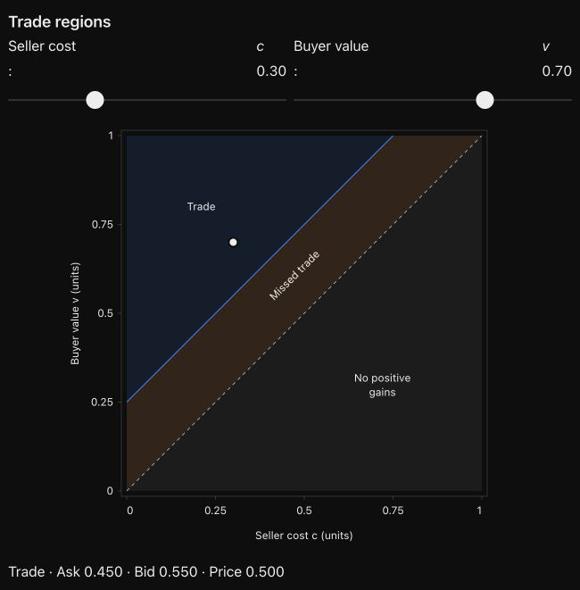

# 76 — Chatterjee–Samuelson Double Auction

The standard linear Bayesian Nash equilibrium is

```math
\boxed{a(c)=\frac23c+\frac14},
\qquad
\boxed{b(v)=\frac23v+\frac1{12}}.
```

These strategies give the following trade condition:

```math
\boxed{\text{Trade occurs if and only if }v-c\geq\frac14.}
```

This is the standard Chatterjee–Samuelson equilibrium for the midpoint price rule. [gwern.net](https://gwern.net/doc/economics/mechanism-design/auction/1983-chatterjee.pdf?utm_source=chatgpt.com)

Here, “linear” permits a constant term. The precise mathematical term is **affine**.

We use the standard payoff assumption: each person maximizes expected money gain. This assumption means that both people are **risk neutral**.

## 1. The story: one bike and two private numbers

Maya owns a bike. Ben wants to buy it.

Maya knows her cost $c$. This cost measures what she gives up when she sells the bike. Ben knows his value $v$. This value measures what the bike is worth to him.

Each person knows only their own number. Both know that the other number has a uniform distribution on $[0,1]$.

For the story, let one unit equal \$1,000. Thus, $c=0.30$ means a cost of \$300.

Maya and Ben each write an offer on a card. They submit their cards at the same time.

The sale rule is:

- Maya submits an ask $a$.

- Ben submits a bid $b$.

- If $b\geq a$, Ben buys the bike at price $p=(a+b)/2$.

- If $b\lt a$, no sale occurs.

If trade occurs, their gains are

```math
u_S=p-c,
\qquad
u_B=v-p.
```

If no trade occurs, both gains are zero.

### Each offer changes two things

A higher ask increases Maya’s price in sales that still occur. But it also removes some possible buyers.

A higher bid increases Ben’s chance of a purchase. But it also increases his price in purchases that would already occur.

**Each person must balance the price against the chance of trade.**

This balance determines the equilibrium.

## 2. What an equilibrium must establish

A **strategy** gives an offer for each possible private number.

The seller uses $a(c)$. The buyer uses $b(v)$.

A **best response** gives the largest expected gain against the other person’s strategy. A Bayesian Nash equilibrium makes each person’s strategy a best response.

The word “Bayesian” concerns the unknown private information. Each person calculates expected gain over the other person’s possible private number.

Independence matters here. Knowledge of $v$ gives the buyer no information about $c$. Knowledge of $c$ gives the seller no information about $v$.

We will find the equilibrium in two stages:

1. Find straight-line strategies that satisfy the best-response equations.

2. Check that no possible bid or ask gives a larger expected gain.

The second stage is necessary. A first-order condition alone does not establish equilibrium.

We restrict the **candidate strategies** to straight lines. We will permit **all possible quotes** when we check deviations.

### Start with unknown coefficients

Write

```math
a(c)=\alpha+\beta c,
\qquad
b(v)=\gamma+\delta v,
```

where

```math
\beta>0,\qquad \delta>0.
```

Thus, higher seller costs produce higher asks. Higher buyer values produce higher bids.

Because the private numbers are uniform, the offers are also uniform:

```math
a(c)\sim U[\alpha,\alpha+\beta],
```

```math
b(v)\sim U[\gamma,\gamma+\delta].
```

We first examine quotes inside the other person’s offer range. We will check quotes outside these ranges later.

## 3. Find the buyer’s best response

Fix the seller’s strategy:

```math
a(c)=\alpha+\beta c.
```

Suppose that a buyer with value $v$ submits an arbitrary bid $x$.

The letter $x$ represents a choice. We have not yet imposed the proposed strategy $b(v)$.

### Step 1: Identify the sellers who trade

Trade occurs when

```math
x\geq\alpha+\beta c.
```

Since $\beta>0$,

```math
c\leq\frac{x-\alpha}{\beta}.
```

For a bid inside the seller’s offer range, define

```math
t=\frac{x-\alpha}{\beta}\in[0,1].
```

The buyer trades with sellers whose costs lie between $0$ and $t$.

Since seller cost is uniform,

```math
\Pr(\text{trade}\mid x)=t
=\frac{x-\alpha}{\beta}.
```

**Lay explanation:** The buyer chooses how much of the seller population to include. A higher bid includes sellers with higher costs.

### Step 2: Calculate the average price when trade occurs

Conditional on trade, seller cost is uniform on $[0,t]$. Therefore,

```math
\mathbb E[c\mid\text{trade}]=\frac t2.
```

The average ask among those sellers is

```math
\mathbb E[a(c)\mid\text{trade}]
=\alpha+\beta\frac t2
=\frac{\alpha+x}{2}.
```

The transaction price averages the buyer’s bid and the seller’s ask. Thus,

```math
\mathbb E[p\mid\text{trade}]
=
\frac12\left(x+\frac{\alpha+x}{2}\right)
=
\frac{3x+\alpha}{4}.
```

The conditioning is important. Sellers who trade with this buyer have asks no greater than $x$.

We must use the average ask among those sellers.

### Step 3: Write expected gain

Expected gain equals the trade probability multiplied by the average gain from a trade:

```math
\Pi_B(x;v)
=
\frac{x-\alpha}{\beta}
\left(v-\frac{3x+\alpha}{4}\right).
```

The same expression follows from the payoff integral:

```math
\Pi_B(x;v)
=
\int_0^{(x-\alpha)/\beta}
\left[v-\frac{x+\alpha+\beta c}{2}\right]dc.
```

The integral includes every seller cost that permits trade. Costs outside this interval contribute zero.

### Step 4: Maximize expected gain

Differentiate with respect to $x$:

```math
\frac{\partial\Pi_B}{\partial x}
=
\frac1\beta
\left(v-\frac32x+\frac12\alpha\right).
```

At an interior optimum,

```math
v-\frac32x+\frac12\alpha=0.
```

Therefore,

```math
\boxed{x=\frac23v+\frac13\alpha.}
```

The second derivative is negative:

```math
\frac{\partial^2\Pi_B}{\partial x^2}
=
-\frac{3}{2\beta}\lt 0.
```

Thus, expected gain is strictly concave within this range. The first-order condition gives its unique maximum there.

For the proposed buyer strategy to match this best response,

```math
\gamma+\delta v
=
\frac23v+\frac13\alpha.
```

Match the coefficients:

```math
\boxed{\delta=\frac23},
\qquad
\boxed{\gamma=\frac{\alpha}{3}}.
```

### The economic meaning of the derivative

We can also write the derivative as

```math
\frac{\partial\Pi_B}{\partial x}
=
\underbrace{\frac{v-x}{\beta}}_{\text{gain from additional trades}}
-
\underbrace{\frac{x-\alpha}{2\beta}}_{\text{higher price on existing trades}}.
```

A small bid increase admits more sellers. At the trade boundary, the seller’s ask equals $x$, so the buyer gains $v-x$.

The same bid increase raises the price on every existing trade. The price rises by half of the bid increase.

The best bid makes these two effects equal.

## 4. Find the seller’s best response

Now fix the buyer’s strategy:

```math
b(v)=\gamma+\delta v.
```

Define the highest possible buyer bid:

```math
\bar b=\gamma+\delta.
```

Suppose that a seller with cost $c$ submits an arbitrary ask $y$.

### Step 1: Identify the buyers who trade

Trade occurs when

```math
\gamma+\delta v\geq y.
```

Thus,

```math
v\geq\frac{y-\gamma}{\delta}.
```

For an ask inside the buyer’s offer range,

```math
\Pr(\text{trade}\mid y)
=
1-\frac{y-\gamma}{\delta}
=
\frac{\bar b-y}{\delta}.
```

**Lay explanation:** A higher ask removes buyers from the lower end of the accepted group.

### Step 2: Calculate the average price when trade occurs

Conditional on trade, buyer bids are uniform on $[y,\bar b]$. Therefore,

```math
\mathbb E[b(v)\mid\text{trade}]
=
\frac{y+\bar b}{2}.
```

The average transaction price is

```math
\mathbb E[p\mid\text{trade}]
=
\frac12\left(y+\frac{y+\bar b}{2}\right)
=
\frac{3y+\bar b}{4}.
```

### Step 3: Write and maximize expected gain

The seller’s expected gain is

```math
\Pi_S(y;c)
=
\frac{\bar b-y}{\delta}
\left(\frac{3y+\bar b}{4}-c\right).
```

Equivalently,

```math
\Pi_S(y;c)
=
\int_{(y-\gamma)/\delta}^{1}
\left[\frac{y+\gamma+\delta v}{2}-c\right]dv.
```

Differentiate:

```math
\frac{\partial\Pi_S}{\partial y}
=
\frac1\delta
\left(c+\frac12\bar b-\frac32y\right).
```

Set the derivative equal to zero:

```math
c+\frac12\bar b-\frac32y=0.
```

Hence,

```math
\boxed{y=\frac23c+\frac13\bar b}
=
\boxed{\frac23c+\frac13(\gamma+\delta)}.
```

The second derivative is

```math
\frac{\partial^2\Pi_S}{\partial y^2}
=
-\frac{3}{2\delta}\lt 0.
```

This gives the unique maximum within the relevant range.

Match this best response to the proposed seller strategy:

```math
\alpha+\beta c
=
\frac23c+\frac13(\gamma+\delta).
```

Therefore,

```math
\boxed{\beta=\frac23},
\qquad
\boxed{\alpha=\frac{\gamma+\delta}{3}}.
```

### The seller’s balance

The derivative also has a direct economic form:

```math
\frac{\partial\Pi_S}{\partial y}
=
\underbrace{\frac{\bar b-y}{2\delta}}_{\text{higher price on remaining trades}}
-
\underbrace{\frac{y-c}{\delta}}_{\text{gain lost from excluded trades}}.
```

A higher ask raises the price in trades that remain. But it also excludes some buyers.

At the boundary, an excluded buyer would have paid $y$. The seller loses gain $y-c$ from that trade.

The best ask balances these effects.

## 5. Solve the four coefficients

The buyer’s best response gives

```math
\delta=\frac23,
\qquad
\gamma=\frac{\alpha}{3}.
```

The seller’s best response gives

```math
\beta=\frac23,
\qquad
\alpha=\frac{\gamma+\delta}{3}.
```

Substitute the buyer’s conditions into the seller’s intercept condition:

```math
\alpha
=
\frac{\alpha/3+2/3}{3}.
```

Multiply by $9$:

```math
9\alpha=\alpha+2.
```

Therefore,

```math
\alpha=\frac14.
```

Then

```math
\gamma=\frac{\alpha}{3}=\frac1{12}.
```

The candidate strategies are therefore

```math
\boxed{
a(c)=\frac23c+\frac14,
\qquad
b(v)=\frac23v+\frac1{12}.
}
```

### Why both slopes equal two-thirds

For an active buyer, the best-response equation is

```math
v-b=\frac12(b-\alpha).
```

The buyer leaves some distance between the bid and the value. That distance equals half the distance between the bid and the lowest ask.

Solving this balance produces the coefficient $2/3$.

The seller faces the corresponding balance:

```math
a-c=\frac12(\bar b-a).
```

This also produces the coefficient $2/3$.

### Why the intercepts differ

The buyer responds to the **lowest ask**. The seller responds to the **highest bid**.

These are different ends of the offer ranges. Their intercepts therefore differ.

The strategies still satisfy a useful symmetry:

```math
a(c)=1-b(1-c).
```

You can verify this directly:

```math
1-b(1-c)
=
1-\left[\frac23(1-c)+\frac1{12}\right]
=
\frac23c+\frac14.
```

## 6. Check all types and all deviations

We have found a candidate. We must now check the boundaries.

The candidate offer ranges are

```math
a(c)\in\left[\frac14,\frac{11}{12}\right],
\qquad
b(v)\in\left[\frac1{12},\frac34\right].
```

These ranges identify which types can trade.

### Buyers with $v>1/4$

Their proposed bids satisfy

```math
\frac14\lt b(v)\leq\frac34.
```

These bids lie inside the seller’s ask range. The strict concavity calculation therefore applies.

The proposed bid gives positive expected gain. A bid below $1/4$ gives zero expected gain, because it cannot reach any seller.

A bid above $11/12$ buys from every seller. A further increase changes no trade decision, but raises the price.

Thus, no bid above $11/12$ improves on the bid $11/12$. The interior maximum already gives at least as much as that endpoint.

This checks all possible bids for these buyers.

### Buyers with $v\leq1/4$

Every seller asks at least $1/4$.

If a buyer causes trade, then

```math
p=\frac{a+b}{2}\geq a\geq\frac14.
```

A buyer with $v\leq1/4$ cannot obtain a positive gain from such a trade.

The proposed strategy gives

```math
b(v)\leq\frac14.
```

Its expected gain is zero. Therefore, it is a best response.

At $v=1/4$, the bid can match the ask of seller type $c=0$. That seller type has probability zero.

### Sellers with $c\lt 3/4$

Their proposed asks satisfy

```math
\frac14\leq a(c)\lt \frac34.
```

These asks lie inside the buyer’s bid range. The strict concavity calculation again applies.

The proposed ask gives positive expected gain. An ask above $3/4$ gives zero expected gain, because no buyer can meet it.

An ask below $1/12$ sells to every buyer. Raising such an ask toward $1/12$ increases the price without losing any buyers.

Thus, no ask below $1/12$ improves on that endpoint. The interior maximum already gives at least as much as the endpoint.

### Sellers with $c\geq3/4$

Every buyer bids at most $3/4$.

Whenever trade occurs,

```math
p=\frac{a+b}{2}\leq b\leq\frac34.
```

A seller with $c\geq3/4$ cannot obtain a positive gain from such a trade.

The proposed strategy gives

```math
a(c)\geq\frac34.
```

Its expected gain is zero. Therefore, it is a best response.

This establishes the Bayesian Nash equilibrium.

### A subtle feature of the inactive types

For a buyer with $v\lt 1/4$, the formula gives

```math
b(v)>v.
```

This does not cause a loss in equilibrium. The bid remains below every seller’s ask.

For a seller with $c>3/4$, the formula gives

```math
a(c)\lt c.
```

This also causes no loss in equilibrium. The ask remains above every buyer’s bid.

Thus, the straight lines remain valid across the full interval $[0,1]$. Types outside the active ranges have zero trade probability.

## 7. Determine the trade outcome

Substitute the equilibrium strategies into the trade rule:

```math
b(v)\geq a(c).
```

Then

```math
\frac23v+\frac1{12}
\geq
\frac23c+\frac14.
```

Rearrange:

```math
\frac23(v-c)\geq\frac16.
```

Therefore,

```math
\boxed{v-c\geq\frac14.}
```

The intercept difference is $1/6$. Dividing this difference by the common slope $2/3$ gives the required value difference $1/4$.

### The price when trade occurs

The transaction price is

```math
p(c,v)
=
\frac12\left[
\frac23c+\frac14+
\frac23v+\frac1{12}
\right].
```

Hence,

```math
\boxed{p(c,v)=\frac{c+v}{3}+\frac16.}
```

The midpoint rule averages the submitted offers. It gives equal buyer and seller gains only when

```math
p=\frac{c+v}{2}.
```

For this equilibrium, that equality requires $c+v=1$.

### The difference between private gain and total gain

When trade occurs, total gain is

```math
u_S+u_B
=
(p-c)+(v-p)
=
v-c.
```

The price determines how the traders divide the gain. It cancels from their combined gain.

Thus, a rule that captures every positive gain would trade whenever $v>c$.

The equilibrium has a stricter requirement. It loses all trades for which

```math
\boxed{0\lt v-c\lt \frac14.}
```

The diagram shows this lost-trade region. Change the cost or value to inspect a pair.

[](https://navidrezazad.github.io/Game_Theory/)

### Return to Maya and Ben

Suppose that

```math
c=0.30,\qquad v=0.70.
```

Maya asks

```math
a(0.30)=0.45.
```

Ben bids

```math
b(0.70)=0.55.
```

They trade at

```math
p=\frac{0.45+0.55}{2}=0.50.
```

Maya gains $0.20$. Ben also gains $0.20$.

In the bike story, the price is \$500. Each person gains \$200.

Now suppose that

```math
c=0.40,\qquad v=0.60.
```

The total possible gain is $0.20$. But the offers are

```math
a(0.40)=\frac{31}{60}\approx0.5167,
```

```math
b(0.60)=\frac{29}{60}\approx0.4833.
```

The bid is below the ask, so no sale occurs.

A price of $0.50$ would give each person a gain of $0.10$. Yet each chooses an offer before learning the other’s private number.

Each equilibrium offer maximizes expected gain under that uncertainty. The auction permits only one simultaneous offer from each person.

This explains how optimal individual choices can produce a missed sale.

## 8. Measure the effects

The strategies already solve the problem. The following calculations show their economic consequences.

### Trade probability

For a seller with cost $c\leq3/4$, trade requires

```math
v\geq c+\frac14.
```

Since $v$ is uniform,

```math
\Pr(\text{trade}\mid c)=\frac34-c.
```

Integrate over seller costs:

```math
\Pr(\text{trade})
=
\int_0^{3/4}\left(\frac34-c\right)dc.
```

Therefore,

```math
\boxed{\Pr(\text{trade})=\frac9{32}=28.125\%.}
```

A rule that trades whenever $v\geq c$ has trade probability

```math
\Pr(v\geq c)=\frac12.
```

Thus, the equilibrium captures

```math
\frac{9/32}{1/2}
=
\frac9{16}
=
56.25\%
```

of the opportunities for a beneficial trade.

### Expected gain for each private type

Consider an active buyer with $v>1/4$.

This buyer trades with sellers whose costs satisfy

```math
0\leq c\leq v-\frac14.
```

The trade probability is therefore

```math
v-\frac14.
```

Conditional on trade, the average seller cost is

```math
\frac{v-1/4}{2}.
```

Use the equilibrium price formula to calculate the average transaction price:

```math
\mathbb E[p\mid v,\text{trade}]
=
\frac13\left(v+\frac{v-1/4}{2}\right)+\frac16
=
\frac v2+\frac18.
```

The buyer’s average gain per trade is

```math
v-\mathbb E[p\mid v,\text{trade}]
=
\frac12\left(v-\frac14\right).
```

Multiply this gain by the trade probability:

```math
\boxed{
U_B(v)=
\begin{cases}
0,&v\leq\frac14,\\[4pt]
\frac12\left(v-\frac14\right)^2,&v>\frac14.
\end{cases}
}
```

The corresponding seller calculation gives

```math
\boxed{
U_S(c)=
\begin{cases}
\frac12\left(\frac34-c\right)^2,&c\lt \frac34,\\[4pt]
0,&c\geq\frac34.
\end{cases}
}
```

These expressions also confirm that active types obtain positive expected gains.

### Expected total gain

Before either private number is known, the buyer’s expected gain is

```math
\mathbb E[U_B]
=
\frac12\int_{1/4}^{1}
\left(v-\frac14\right)^2dv
=
\frac9{128}.
```

The seller has the same expected gain:

```math
\mathbb E[U_S]=\frac9{128}.
```

Therefore,

```math
\boxed{
\mathbb E[\text{total gain in equilibrium}]
=
\frac9{64}.
}
```

If every beneficial trade occurred, expected total gain would be

```math
\int_0^1\int_c^1(v-c)\,dv\,dc
=
\frac16.
```

The equilibrium therefore captures

```math
\frac{9/64}{1/6}
=
\boxed{\frac{27}{32}=84.375\%}
```

of the maximum expected total gain.

This percentage exceeds the percentage of trade opportunities captured. The missing trades have small gains, because their value differences are below $1/4$.

## 9. State the equilibrium claim precisely

We have found the standard increasing affine equilibrium with positive trade probability.

The game also has other equilibria. For example,

```math
a(c)\equiv1,
\qquad
b(v)\equiv0
```

forms an equilibrium with no trade.

Against an ask of $1$, a buyer must pay at least $1$ to cause trade. No buyer has value above $1$.

Against a bid of $0$, a seller can receive at most $0$ by causing trade. No seller has cost below $0$.

Thus, neither person can obtain a positive gain through a unilateral deviation.

For the equilibrium requested in the problem, the substantive result remains:

```math
\boxed{
a(c)=\frac23c+\frac14,\qquad
b(v)=\frac23v+\frac1{12},\qquad
\text{trade}\iff v-c\geq\frac14.
}
```

Each person’s attempt to obtain a better price creates the gap between efficient trade and equilibrium trade.
